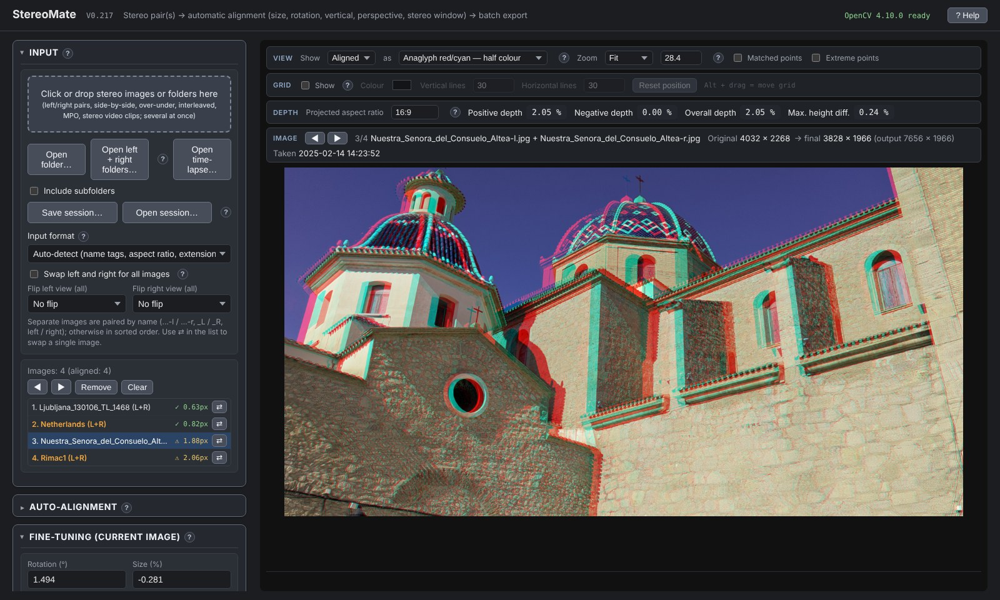
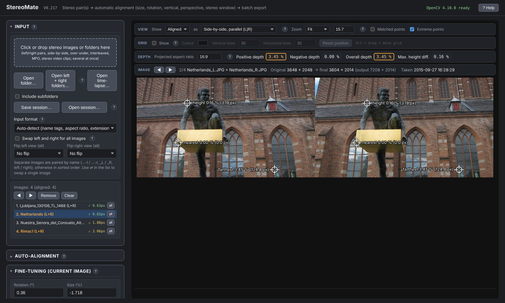
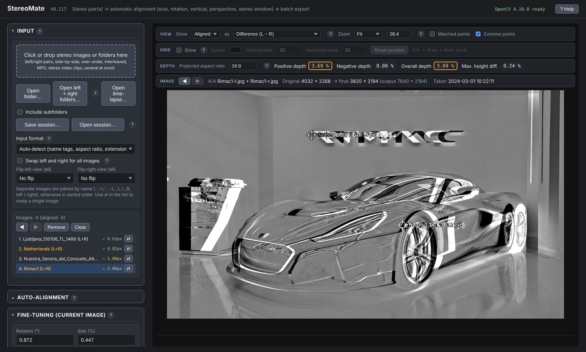
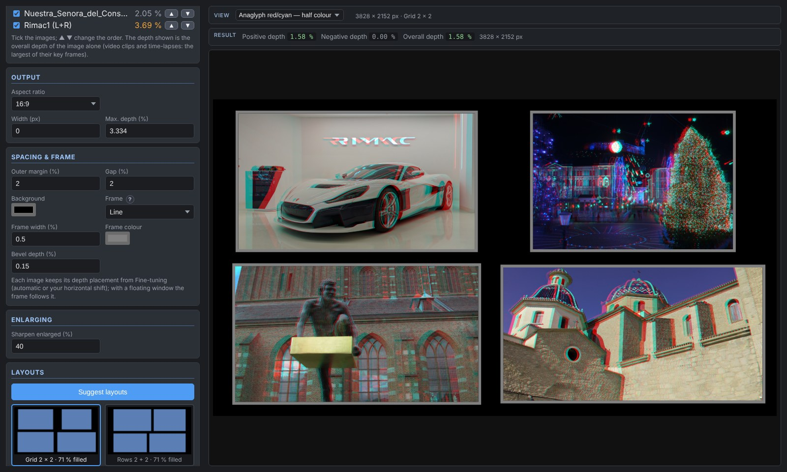
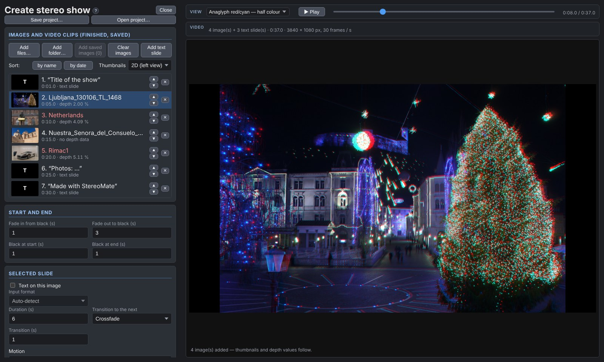
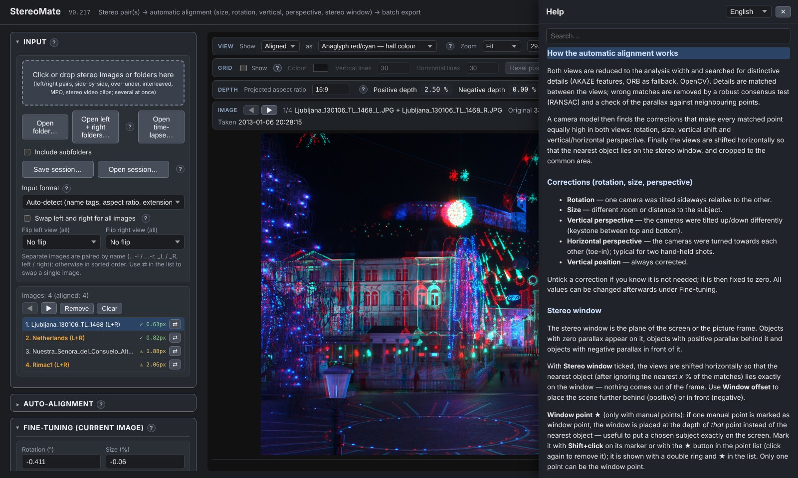

# StereoMate

**StereoMate aligns and finishes stereoscopic (3D) photos and videos.**
It takes the two views of a stereo pair, from a twin-lens 3D camera, two cameras on a bar, or one camera moved
sideways, and corrects everything that makes 3D images tiring to watch: different rotation, size and height of the
two views, perspective differences, and objects that come out of the stereo window. It shows how deep the result is,
warns when it is too deep for comfortable viewing, and saves it in all common stereo formats.
Video clips, time-lapses, compositions of several images and complete slide shows with music can be made as well.

StereoMate is free and open source (MIT licence). It runs on **Windows** and **Linux** as a desktop program,
and in **Chrome or Edge** as a web page. The pictures never leave your computer.

## Download

**[Download the latest version](https://github.com/crunchy3d/StereoMate/releases/latest)** (open *Assets* at the bottom of the release):

| System | File | Notes |
|---|---|---|
| Windows 10 / 11 | `StereoMate_…_x64-setup.exe` | installer (recommended) |
| Windows 10 / 11 | `StereoMate_…_x64_en-US.msi` | installer for managed computers |
| Windows 10 / 11 | `StereoMate_…_portable.exe` | no installation: just start it |
| Linux | `StereoMate_…_amd64.AppImage` | no installation: make it executable and start it |
| Linux (Debian, Ubuntu, Mint) | `StereoMate_…_amd64.deb` | installer |
| Any system, Chrome or Edge | `StereoMate_web_….zip` | web version: unpack and open `StereoMate.html` (keep `opencv.js` next to it) |

> **Windows security warning.** StereoMate is not signed with a paid code-signing certificate, so Windows SmartScreen
> may show “Windows protected your PC” the first time. Click **More info → Run anyway**. The program is built
> automatically on GitHub from the files in this repository (see *How it is built*).

**Try it in the browser:** [crunchy3d.github.io/StereoMate](https://crunchy3d.github.io/StereoMate/).
The web version has fewer capabilities than the desktop program; see [Desktop or web version?](#desktop-or-web-version)

## What StereoMate does

### Loading
- Left + right files (paired by name: `_L`/`_R`, `-l`/`-r`, `left`/`right` …), side-by-side (parallel or cross-eyed, full or half), over-under, interleaved, **MPO** and **JPS** files.
- Whole folders; **left and right folders** (pairs by name, by the EXIF capture time or by order); subfolders.
- Mirror and beam-splitter rigs and cameras on their side: either view can be **flipped** and **rotated** (90° / 180° / 270°), for images, time-lapses and video clips; the rotation tag of phone videos is applied.
- **Sessions** save the whole list with every adjustment, so you can continue later. Images corrected in another program can take the place of the originals and keep all settings — found by the same name, a name pattern (e.g. “_edit”) or the capture time; **Replace file…** does the same in the list.

### Automatic alignment
- Finds thousands of matching details in both views (OpenCV: AKAZE / ORB, robust RANSAC) and corrects **rotation, size, vertical shift and vertical / horizontal perspective** with an exact camera model.
- Places the **stereo window** at the nearest object, so nothing comes out of the frame unintentionally.
- Corrects lens barrel distortion; **Auto-align all** processes a whole list.
- **Manual points** with a magnifier and sub-pixel matching, when automatic alignment is not enough.
- **Fine-tuning** of every value, and applying the values of one image to a whole series (fixed rigs, time-lapses) — all at once or per section (fine-tuning, crop, floating window, brightness / colour), with undo.
- **Already aligned images** (e.g. from StereoPhoto Maker): *only measure depth* finds the matching points and measures depth, extreme points and the remaining vertical error without changing the image.

### Depth control
- **Positive, negative and overall depth** and the largest height difference, in % of the image width, for the projected aspect ratio.
- Colour warnings above the usual comfort limits (3.334 % / 4 %); too deep results can be saved into separate folders.
- **Extreme points**: the nearest and farthest point and the point of the largest height difference are marked in the image.

### Finishing
- **Crop** with fixed or free aspect ratio, edited directly on the image, snapping to the image borders.
- **Floating window**: black stripes that bring the image edges forward (automatic or manual).
- **Brightness and colour matching** of the two views (automatic, plus manual levels, contrast, saturation, temperature and tint).
- Views: anaglyphs (several kinds, including Dubois), side-by-side parallel / cross-eyed, **Difference (L − R)**, alternating L / R (flashing), **row / column interleaved** (passive 3D monitors) and **checkerboard** (DLP 3D), single view; zoom, magnifier and grid; **image only** on the whole screen (key I).

### Saving
- Side-by-side (full / half, parallel / cross-eyed), over-under (full / half), **MPO**, separate left + right JPGs, interlaced, anaglyph.
- **Size per view**, separately for images and for videos: original, Full HD / 4K UHD / any W × H, long side, width or scale; for a fixed size the whole image with **black bars**, the frame **filled** (edges trimmed) or the whole image without bars.
- High-quality JPEG with selectable chroma subsampling; EXIF data kept; depth values in the file name (optional).
- **Save all** saves the whole list (and renders all video clips).

### Compose: several images in one
- Puts several aligned images (and video clips) into one stereo picture with background, gaps and frames (line, double line, 3D bevel, rounded or oval).
- Suggests layouts within a depth limit and keeps the depth order of overlapping images.
- With video clips or time-lapses in it, the composition is rendered as a **video** (each clip with its own start time, holding its last frame or looping).

### Video
- **Stereo video clips** (side-by-side or top-bottom): one frame is aligned with all the tools above; **key frames** follow changes during the clip, then every frame is warped on the graphics card and saved as MP4 (H.264, HEVC, AV1 or VP9) with the 3D tag for YouTube and VR players. Videos keep the frame rate of their source by default; mixed frame rates are pointed out before rendering. The preview plays with sound.
- **Left + right video files** from two cameras: synchronised automatically by the sound (or by the motion).
- **Stereo from a mono video** taken while moving sideways (car, train, walking): the delay between the two views is found for a chosen depth, optionally adapted during the clip.
- **Time-lapses**: a folder of stereo images becomes one entry, aligned once (or with key frames) and rendered at any frame rate.
- In the desktop program **ffmpeg** (if installed) reads other formats (AVI, MKV …) and can convert the results.

### Create stereo show
- A slide show from the stereo images and video clips: gentle zoom, panning and depth motion, transitions, text slides, music, narration and other sounds (with automatic volume reduction under speech), rendered as an MP4 video. The images and clips of the list are added automatically, aligned as they are; finished files can be added too.

### Second screen
- A separate window that shows **only the image**, aligned, cropped and corrected, on another monitor, projector or 3D TV, and follows every change you make. While Compose is open it shows the composition.
- Formats: side-by-side and top-bottom (full or half), row or column interleaved (passive 3D monitors), checkerboard (DLP projectors), anaglyphs, single view. Full screen with a double-click.
- Each half can be **mirrored or rotated** for mirror stereoscopes, e.g. two monitors joined into one screen and viewed through mirrors.

### Help
- Built-in help in **English, German, French, Dutch and Slovenian**; a **?** next to every section, **F1** on any field, and a table of all keyboard shortcuts.

## Quick start

1. Click the drop field (or drag files or a folder onto it) and load your stereo pairs.
2. Click **Auto-align all**.
3. Check each image: the depth values in the **DEPTH** bar, the view (anaglyph, side-by-side, Difference …), the crop.
4. Correct what is needed under **Fine-tuning** (in *Stereo alignment*), **Crop and window** or with **Manual points**.
5. Choose the format under **Export** and click **Save all**.
6. Optional: **Compose** several images into one, or make a slide show with **Create stereo show**.

Press **F1** or click **?** for help on any part of the program.

## Desktop or web version?

Both are the same program. The **desktop program** is recommended; the **web version** (in Chrome or Edge on a computer) is handy for trying it out.

| | Desktop (Windows / Linux) | Web (Chrome / Edge) |
|---|---|---|
| Alignment, depth, crop, colour, Compose, all image formats | ✓ | ✓ |
| Saving into the chosen folders | ✓ | ✓ (asks for the folder) |
| Video clips MP4 / MOV (H.264, HEVC, AV1, VP9) | ✓ | ✓ |
| Other video formats (AVI, MKV …), conversion with ffmpeg | ✓ (with ffmpeg) | — |
| Deleting files to the recycle bin | ✓ | — |
| Sessions find the images by their paths | ✓ | you choose the folder again |
| Opening files by double-click / from the command line | ✓ | — |
| Firefox, Safari, phones and tablets | — | not supported (no folder access, no video) |

Nothing is uploaded in either version: all processing happens on your computer.

**System requirements:** a 64-bit computer with a graphics card that supports WebGL 2 (practically all from the last ten years).
8 GB of memory or more is recommended for large images and 4K video. Windows needs the WebView2 runtime, which is part of Windows 10 and 11.

## Questions, problems, suggestions

Please open an **[Issue](https://github.com/crunchy3d/StereoMate/issues)** (a free GitHub account is needed).
Describe what you did and what happened; a screenshot helps. Issues are public, so do not post private pictures or data.

## How it is built

The repository contains the program as one project archive (`StereoMate-tauri.zip`: the program `dist/index.html`,
OpenCV.js and the [Tauri](https://tauri.app) desktop wrapper) and a GitHub Actions workflow
(`.github/workflows/build.yml`). The workflow builds the Windows and Linux programs and the web version from it,
attaches them to each release and publishes the web version on GitHub Pages.

## Credits and licence

Programmed by **Damir Vrančić and Claude**, 2026.

StereoMate is released under the **MIT licence** (see [LICENSE](LICENSE)): you may use, copy, change and share it,
also commercially, as long as the copyright notice is kept. It includes OpenCV.js (Apache-2.0), mp4-muxer (MIT) and
Tauri (MIT / Apache-2.0), see [THIRD_PARTY_NOTICES.md](THIRD_PARTY_NOTICES.md).
